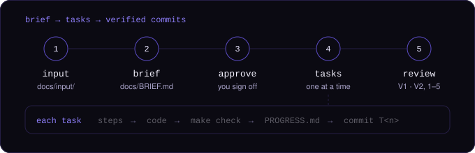
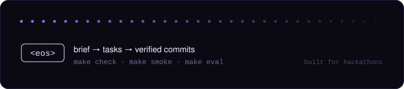

<p align="center">
  
</p>

<p align="center">
  
</p>

<p align="center">
  Рабочий каркас из трёх сервисов и процесс, по которому ИИ-агент ведёт проект от брифа до проверенных коммитов.
</p>

<p align="center">
  <a href="#идея">Идея</a> ·
  <a href="#как-устроено">Как устроено</a> ·
  <a href="#быстрый-старт">Быстрый старт</a> ·
  <a href="#как-вести-проект">Как вести проект</a> ·
  <a href="#куда-писать-код">Куда писать код</a> ·
  <a href="#ии-часть">ИИ-часть</a> ·
  <a href="#проверки">Проверки</a> ·
  <a href="#вопросы-и-ответы">Вопросы</a>
</p>


## Идея

На хакатоне время утекает в двух местах. Первое — настройка: сервисы, база, ключи, связи между ними. Второе — ИИ-агент (Claude Code, Codex, Cursor): без чётких правил он делает лишнее, ломает соседний код и говорит «готово», ничего не проверив. Шаблон снимает обе проблемы.

| Принцип | Что это даёт |
| --- | --- |
| Работает с первой минуты | Сервисы уже связаны. Вопрос из браузера доходит до модели и возвращается с ответом. Этот пример показывает, куда писать свой код. |
| Агент работает по процессу | Сначала бриф, потом задачи из сценария демо. Перед «готово» агент запускает проверки, после каждой задачи делает коммит. |
| Ничего лишнего | Один сквозной пример. Новые слои и зависимости появляются, только когда их требует задача. |

Подходит для чат-ассистентов, RAG (ответы по вашим документам), агентов и MCP-серверов (MCP — протокол, через который модель вызывает внешние инструменты). Для проектов дольше трёх дней есть шаблоны в `docs/long-project/`.


## Как устроено

<p align="center">
  
</p>

- **frontend** (Vite + React) — экраны. Ходит только в backend, адрес берёт из `VITE_API_URL`.
- **backend** (FastAPI + Postgres) — данные и правила продукта. Это единственный API для фронта. В ml ходит по адресу из `ML_URL`.
- **ml** (FastAPI) — вся ИИ-часть: промпты, вызовы модели, RAG, агенты, эвалы. Ключ модели лежит только здесь.

Код между сервисами не импортируется. Общие у них только схемы запросов и ответов.

<details>
<summary><b>Путь одного вопроса по файлам</b></summary>

<br>

| Шаг | Сервис | Файлы |
| --- | --- | --- |
| 1. Пользователь вводит вопрос | frontend | `frontend/src/features/questions/components/AskPanel.tsx`, `hooks/useQuestions.ts` |
| 2. Запрос `POST /api/v1/questions` | frontend | `frontend/src/features/questions/api.ts`, `frontend/src/shared/api/client.ts` |
| 3. Маршрут принимает запрос и проверяет схему | backend | `backend/app/api/routes/questions.py`, `backend/app/api/schemas/question.py` |
| 4. Сервис ведёт сценарий | backend | `backend/app/services/question_service.py`, `backend/app/domain/question.py` |
| 5. Клиент шлёт `POST /api/v1/ask` в ml | backend | `backend/app/infra/ml_client.py` |
| 6. Маршрут ml принимает вопрос | ml | `ml/app/api/routes/ask.py`, `ml/app/api/schemas/ask.py` |
| 7. Сервис берёт системный промпт | ml | `ml/app/ask/service.py`, `ml/app/llm/prompts.py`, `ml/prompts/ask.md` |
| 8. Вызов модели и запись в лог | ml | `ml/app/llm/client.py` |
| 9. Вопрос и ответ сохраняются в базу и уходят на фронт | backend | `backend/app/infra/db/question_repository.py`, `backend/app/infra/db/models.py` |

История последних 20 вопросов отдаётся через `GET /api/v1/questions`.

</details>


## Быстрый старт

Нужны [Docker](https://docs.docker.com/get-docker/), [uv](https://docs.astral.sh/uv/) и Node.js 20+.

```bash
# создать .env из .env.example в корне и в каждом сервисе
make env
```

Впишите в `ml/.env` модель и ключ:

```bash
LLM_MODEL=<id модели Anthropic>
ANTHROPIC_API_KEY=<ваш ключ>
```

```bash
# поднять Postgres, backend, ml и frontend в docker
make up

# во втором терминале: сквозная проверка, все строки должны быть ok
make smoke

# линт и форматирование перед каждым коммитом
make hooks
```

Откройте http://localhost:5173 и задайте вопрос.

> [!TIP]
> Можно без Docker. После `make env` запустите в трёх терминалах `make backend-dev`, `make ml-dev` и `make frontend-dev`. Backend тогда работает на SQLite (`backend/dev.db`), Postgres не нужен.


## Как вести проект

<p align="center">
  
</p>

**1. Соберите материалы.** Положите в `docs/input/` всё, что есть: описание хакатона, критерии жюри, идею, материалы организаторов. Подойдёт MD или обычный текст. Агент эти файлы не правит.

**2. Попросите агента заполнить бриф.** Бриф — это `docs/BRIEF.md`, одна страница вместо ТЗ и плана. Скажите: «Прочитай docs/input и заполни docs/BRIEF.md». Агент задаст не больше пяти вопросов, к каждому даст варианты и рекомендацию. Мелочи он решит сам и отметит это в брифе.

**3. Утвердите бриф.** Прочитайте, поправьте и поставьте статус «утверждено». В брифе: что и для кого, критерии жюри, сценарий демо, решение, контракт между сервисами, риски, 5–8 задач, запасной план демо и список «Не делаем». Задачи выводятся из сценария демо и привязаны к критериям, поэтому агент не тратит время на то, за что не дадут баллов.

**4. Ведите задачи по одной.** На каждую задачу агент:

1. Расписывает шаги прямо под задачей в брифе: контракт, ml, backend, frontend, проверка.
2. Пишет код. Если задача про ИИ-часть, сначала пишет эвалы.
3. Запускает проверки и показывает их вывод.
4. Отмечает задачу в брифе, перезаписывает блок «Состояние» в `docs/PROGRESS.md` и делает локальный коммит `T<n>: <что сделано>`.

**5. Проведите ревью.** Задачи V1 (в середине) и V2 (перед показом) — это ревью по критериям жюри. Агент ставит каждому критерию оценку от 1 до 5 и предлагает до трёх улучшений. Код при этом не пишется, решение за вами.

> [!NOTE]
> Перед каждой новой задачей загляните в раздел «Идеи и сомнения» в `docs/PROGRESS.md`. Туда агент пишет, если видит путь лучше брифа или считает условие задачи неверным. Отвечайте «берём», «нет» или «позже».

Если проект дольше трёх дней, вместо брифа возьмите `SPEC.md`, `PLAN.md` и `TASKS.md` из `docs/long-project/`.


## Куда писать код

**Нужна модель — это ml. Нужны данные и состояние — это backend.**

| Что пишете | Куда |
| --- | --- |
| Правила продукта: лимиты, проверки, статусы | `backend/app/services/<feature>_service.py`, сущности и ошибки в `backend/app/domain/<feature>.py` |
| Новая сущность в базе | модель в `backend/app/infra/db/models.py`, репозиторий рядом в `backend/app/infra/db/` |
| Промпт | файл `ml/prompts/<назначение>.md`, загрузка через `load_prompt()` |
| Простой вызов модели | модуль рядом с `ml/app/ask/`, маршрут и схема в `ml/app/api/` |
| RAG | `ml/app/rag/` |
| Агент | `ml/app/agent/` |
| MCP-сервер | `ml/app/mcp/` — тонкая обёртка над соседними модулями ml |
| Экран или компонент | `frontend/src/features/<name>/`, общие UI-примитивы в `frontend/src/shared/ui/` |

Пример: лимит «10 вопросов в день» считается в backend, потому что это правило продукта и счётчик в базе. Сам ответ на вопрос даёт ml.

Папок `rag/`, `agent/` и `mcp/` пока нет. Агент создаст нужную, когда до неё дойдёт задача. Слои и правила каждого сервиса описаны в его `AGENTS.md`.


## ИИ-часть

**Вызов модели** идёт только через `complete()` в `ml/app/llm/client.py`. Функция обращается к Anthropic Messages API напрямую, без SDK. При перегрузке и сбоях API (коды 429, 500, 502–504, 529) и при таймаутах она повторяет запрос. Если модель так и не ответила, маршрут возвращает `502`. Чтобы сменить провайдера, достаточно переписать этот один файл.

**Промпты** лежат файлами в `ml/prompts/`, в коде их нет. Правка промпта видна в git отдельным изменением.

**Лог** каждого вызова пишется в `ml/logs/llm.log.jsonl`: промпт, ответ, задержка, токены, ошибка. Ключа в логе нет никогда.

> [!WARNING]
> Если в промпты попадают персональные данные, поставьте `LLM_LOG_TEXT=false` в `ml/.env`. Тогда в логе останутся только длины текстов.

**Эвалы** — это тесты для ИИ-части. Обычные тесты не замечают, что модель стала отвечать хуже после правки промпта, а эвалы замечают. Случаи лежат в `ml/evals/cases.jsonl`, по одному JSON на строку.

| Тип | Что проверяет | Пример |
| --- | --- | --- |
| `code` | поле ответа равно значению, содержит подстроку или запрос вернул нужный статус | ответ на «Какой город столица Франции?» содержит «Париж» |
| `tool` | агент вызвал нужный инструмент | на «Создай задачу на завтра» вызван `create_task` |
| `judge` | модель-судья оценивает ответ по рубрике | ассистент честно говорит, что не знает номер паспорта |

`make eval` прогоняет случаи против запущенного ml и сохраняет результат в `ml/evals/results/`. Если случай прошёл в прошлый раз, а теперь упал, он помечается как регрессия.

**Плейбуки** в `docs/playbooks/` — короткие подсказки на одну тему. `agents.md`: когда хватит одного вызова модели, а когда нужен агент. `rag.md`: нужен ли поиск и какой. `mcp.md`: как строить MCP-сервер. `evals.md`: как писать эвалы. `security.md`: как не попасть на prompt injection. Агент читает нужный только под задачу.


## Проверки

| Команда | Что ловит | Когда запускать |
| --- | --- | --- |
| `make check` | формат и линт всех сервисов, тесты backend и ml | после каждой задачи |
| `make smoke` | сервисы подняты и связаны, вопрос доходит до модели и обратно | когда задача затрагивает несколько сервисов |
| `make eval` | ответы модели стали хуже, регрессии | после правки промптов, поиска или инструментов агента |
| CI | линт и тесты всех сервисов, проверка типов фронта (`tsc`), сборка docker-образов на push | сам на push и PR в `main` |

В тестах модель и ml подменяются заглушками, поэтому `make check` не нужен ключ.


## Что в репозитории

```
.
├── .agents/skills/          скиллы агента; .claude/skills — ссылка на эту папку
├── .claude/                 настройки Claude Code: что агенту запрещено
├── .github/workflows/       CI
├── backend/                 FastAPI + SQLAlchemy: данные и правила
├── docs/
│   ├── input/               исходные материалы, агент их не правит
│   ├── BRIEF.md             бриф: критерии, демо, контракт, задачи
│   ├── PROGRESS.md          состояние, идеи агента, ревью
│   ├── playbooks/           подсказки: agents, rag, mcp, evals, security
│   ├── long-project/        SPEC, PLAN, TASKS для долгих проектов
│   └── assets/readme/       картинки этого README
├── frontend/                Vite + React + TS + Tailwind + shadcn/ui
├── ml/                      ИИ-часть: вызов модели, промпты, эвалы
├── scripts/                 smoke.sh и генератор картинок README
├── .env.example             порты и доступ к Postgres для docker
├── .mcp.json                Context7: свежая документация библиотек для агента
├── .pre-commit-config.yaml  хуки для make hooks
├── AGENTS.md                правила и команды для агента
├── CLAUDE.md                подключает AGENTS.md для Claude Code
├── Makefile                 все команды проекта
├── docker-compose.yml       db, backend, ml, frontend
└── ruff.toml                общие настройки линтера Python
```

У каждого сервиса свой `AGENTS.md`: слои, правила и команды этого сервиса.


## Агент: правила и скиллы

Полностью правила лежат в `AGENTS.md`. Главные:

- Секреты живут только в `.env`. Агент их не читает, не печатает и не коммитит.
- Сначала контракт между сервисами, потом код с обеих сторон. Код между сервисами не импортируется.
- «Готово» агент говорит только после `make check` с показанным выводом. Если задача затрагивает несколько сервисов, ещё `make smoke`, если промпты или инструменты — `make eval`.
- После задачи агент отмечает её в брифе, обновляет `docs/PROGRESS.md` и делает один локальный коммит `T<n>: …`.

Только после вопроса агент делает push, работает с ветками, rebase и reset, добавляет зависимости и платные сервисы, правит `docs/input/`, утверждённый бриф, `Makefile`, docker, CI и `.env`.

Скилл — это инструкция, которую агент подгружает, только когда задача подходит под её описание. Скиллы лежат в `.agents/skills/`.

| Скилл | Когда срабатывает |
| --- | --- |
| `feature-interview` | старт проекта: превратить `docs/input/` в бриф или в спецификацию для долгого проекта |
| `task-breakdown` | нарезать работу на маленькие задачи, которые работают от экрана до ответа, и расписать шаги перед стартом |
| `clean-architecture` | спроектировать новый модуль в backend или ml, понять, в какой слой класть код, проверить дифф на нарушения слоёв |
| `frontend-design` | новый интерфейс или переделка старого, чтобы он не выглядел шаблонным |
| `diagnosing-bugs` | что-то сломалось, падает, тормозит, или вы просите «разберись» |
| `mcp-builder` | нужен MCP-сервер; в проектах без MCP папку можно удалить |

Откуда взяты скиллы и под какой лицензией — в `.agents/skills/SOURCES.md`.


## Команды

Запускаются из корня репозитория. `make` без аргументов печатает справку.

| Команда | Что делает |
| --- | --- |
| `make env` | создаёт `.env` из `.env.example` там, где его ещё нет |
| `make up` | собирает и поднимает весь стек в docker |
| `make logs` | показывает логи docker compose |
| `make backend-dev` | backend без docker на порту 8000 |
| `make ml-dev` | ml без docker на порту 8100 |
| `make frontend-dev` | `npm install` и frontend без docker на порту 5173 |
| `make lint` | формат и линт всех сервисов; по одному: `backend-lint`, `ml-lint`, `frontend-lint` |
| `make test` | тесты backend и ml; по одному: `backend-test`, `ml-test` |
| `make check` | `lint` + `test` |
| `make smoke` | сквозная проверка запущенного стека |
| `make eval` | эвалы ИИ-части, нужен запущенный ml |
| `make typecheck` | проверка типов mypy в backend и ml |
| `make hooks` | ставит git-хуки: линт и формат перед каждым коммитом |


## Работа в команде

- Агент делает только локальные коммиты. Push, ветки и PR остаются за людьми.
- Строку задачи в `docs/BRIEF.md` правит только её исполнитель.
- Нужно срочно сохранить черновик перед дедлайном — `git commit --no-verify` пропустит хуки.
- Codex и Cursor сами подхватят правила из `AGENTS.md` и скиллы из `.agents/skills/`. Сервер Context7 из `.mcp.json` и запрет на чтение `.env` из `.claude/settings.json` нужно вручную прописать в их собственных настройках.
- На Windows ссылка `.claude/skills` может не распаковаться. Тогда скопируйте папку `.agents/skills` в `.claude/skills`.


## Вопросы и ответы

<details>
<summary><b>Проекту не нужен backend или frontend</b></summary>

<br>

Удалите папку сервиса целиком. `make env` и `make smoke` пропускают отсутствующие папки сами. `Makefile`, `docker-compose.yml` и `.github/workflows/ci.yml` нужно поправить руками. Если фронт пойдёт прямо в ml, добавьте в ml CORS по образцу `backend/app/main.py`: сейчас в ml его нет.

</details>

<details>
<summary><b>Как сменить модель или провайдера</b></summary>

<br>

Модель меняется строкой `LLM_MODEL` в `ml/.env`. Для другого провайдера перепишите `ml/app/llm/client.py`, сохранив сигнатуру `complete()`, и добавьте нужные настройки в `ml/app/config.py` и `ml/.env.example`. Остальной код менять не придётся. SDK провайдера — это новая зависимость, агент спросит перед установкой.

</details>

<details>
<summary><b>Поменял модель данных, и backend падает</b></summary>

<br>

Миграций в шаблоне нет: таблицы создаются при старте (`create_all`), а существующие не меняются. Пересоздайте базу. В docker это `docker compose down -v`, команда удалит и все данные. Без docker удалите `backend/dev.db`. Для долгого проекта подключите Alembic.

</details>

<details>
<summary><b>Почему нет авторизации, стриминга и тестов фронта</b></summary>

<br>

На хакатоне они нужны не всегда, а время на них уходит заметное. Если демо требует, добавьте их задачей в брифе. Стриминг добавляется в `ml/app/llm/client.py`. Для долгого проекта тесты фронта стоит завести сразу, об этом написано в `docs/long-project/README.md`.

</details>

<details>
<summary><b>Как поменять оформление README</b></summary>

<br>

Все картинки рисует `scripts/readme_art.py`. Цвета заданы константами в начале файла, подписи разделителей — в списке `SECTIONS`. После правки запустите из корня `python scripts/readme_art.py`, картинки перезапишутся в `docs/assets/readme/`.

</details>

<br>

<p align="center">
  
</p>
