<p align="center">
  
</p>

Заготовка для хакатонов и коротких проектов с LLM: чат-ассистенты, RAG, агенты, MCP-серверы с сайтом. В ней два слоя:

- **Рабочий каркас** — три сервиса, которые сразу запускаются и проходят сквозной пример «вопрос → ответ модели» от экрана до API модели.
- **Процесс для агента** — документы и правила, по которым агент (Claude Code, Codex, Cursor) превращает описание хакатона в бриф, бриф в задачи, а задачи в проверенные коммиты.


## Как устроено

```
браузер ──► frontend ──HTTP──► backend ──HTTP──► ml ──HTTPS──► API модели
            Vite+React         FastAPI           FastAPI        (Anthropic)
                               + Postgres        промпты, RAG,
                               история,          агенты, эвалы
                               данные
```

- **frontend** ходит только в backend. Адрес берётся из `VITE_API_URL`.
- **backend** хранит данные и это единственный API для фронта. В ml он ходит по `ML_URL`.
- **ml** — вся ИИ-часть. Ключ модели лежит только здесь, наружу из этого сервиса не уходит.
- Код между сервисами не импортируется: общие у них только HTTP-контракты (Pydantic-схемы).

### Сквозной пример

В шаблоне есть одна функция, проведённая через все слои. По ней видно, куда класть код, и её же проверяют тесты, smoke и эвалы:

1. `frontend/src/features/questions/` — поле ввода и список ответов, хук `useQuestions`.
2. `POST /api/v1/questions` в backend: маршрут `api/routes/questions.py` → сервис `services/question_service.py` → клиент `infra/ml_client.py` → сохранение в `infra/db/question_repository.py`.
3. `POST /api/v1/ask` в ml: маршрут `api/routes/ask.py` → `ask/service.py` → `llm/client.py::complete()` с системным промптом из `prompts/ask.md`.
4. Ответ модели возвращается обратно и сохраняется в историю. `GET /api/v1/questions` отдаёт последние 20 вопросов.

Когда появится настоящая функция, пример заменяется или удаляется: его кусочки лежат в `features/questions`, `domain/question.py` и соседних файлах, `ml/app/ask/`, `ml/prompts/ask.md` и `ml/evals/cases.jsonl`.


## Быстрый старт

Нужны Docker, [uv](https://docs.astral.sh/uv/) и Node 20+.

1. `make env` — создаёт `.env` из `.env.example` в корне и в каждом сервисе.
2. В `ml/.env` вписать `LLM_MODEL` и `ANTHROPIC_API_KEY`.
3. `make up` — поднимает Postgres, backend, ml и frontend.
4. `make smoke` — сквозная проверка. Все строки должны быть `ok`.
5. Открыть http://localhost:5173 и задать вопрос.
6. `make hooks` — линт и форматирование перед каждым коммитом.

Без docker: `make backend-dev`, `make ml-dev`, `make frontend-dev` в трёх терминалах. Backend тогда работает на SQLite (`backend/dev.db`).


## Как работать над проектом

### Старт

1. Положить в `docs/input/` всё, что есть: описание хакатона, критерии жюри, идею, материалы организаторов. Подойдут MD или обычный текст.
2. Попросить агента: «Прочитай docs/input и заполни docs/BRIEF.md». Сработает скилл `feature-interview`: агент задаст не больше пяти вопросов по пробелам, каждый с вариантами и рекомендацией, а мелочи решит сам и пометит это в брифе.
3. Прочитать бриф, поправить его и поставить статус «утверждено». Удалить сервисы, которые проекту не нужны: `make smoke` и `make env` пропускают отсутствующие папки сами, а `Makefile`, `docker-compose.yml` и CI нужно поправить руками.

`docs/BRIEF.md` — одна страница вместо ТЗ и плана: что и для кого, критерии жюри, сценарий демо, решение, контракт, риски, 5–8 задач, запасной план демо и «Не делаем». Задачи выводятся из сценария демо и привязаны к критериям, поэтому агент не тратит время на то, за что не дадут баллов.

### Цикл одной задачи

Агент берёт задачи из брифа по одной:

1. Читает блок «Состояние» в `docs/PROGRESS.md` и `git log`.
2. Расписывает шаги задачи прямо под ней в брифе: контракт, ml, backend, frontend, проверка.
3. Пишет код. Если задача касается ИИ-части, сначала пишет случаи эвалов.
4. Запускает `make check`, а если задача затрагивает несколько сервисов, то и `make smoke`. Если менялись промпты или инструменты, ещё `make eval`. Вывод показывает.
5. Отмечает задачу в брифе, перезаписывает «Состояние» в `PROGRESS.md` и делает один локальный коммит `T<n>: …`.

Перед каждой новой задачей загляните в «Идеи и сомнения» в `docs/PROGRESS.md`: туда агент пишет, если видит путь лучше брифа. Отвечайте «берём», «нет» или «позже».

Задачи V1 и V2 в брифе — это ревью по критериям жюри: в середине работы и перед показом. Агент ставит каждому критерию оценку 1–5 и предлагает до трёх улучшений, а решение остаётся за вами.

### Долгий проект

Для проекта длиннее трёх дней вместо брифа берутся `docs/long-project/`: `SPEC.md` (что и зачем, требования `REQ1…`), `PLAN.md` (как строим, принятые решения) и `TASKS.md` (задачи по этапам). Там же написано, что стоит добавить: миграции и тесты фронтенда.


## Что где лежит

```
AGENTS.md                правила и команды для агента; CLAUDE.md его импортирует
docs/
  input/                 исходные материалы (агент их не правит)
  BRIEF.md               бриф: критерии, демо, контракт, задачи
  PROGRESS.md            текущее состояние, идеи агента, ревью, выводы разведки
  playbooks/             короткие подсказки: agents, rag, mcp, evals, security
  long-project/          SPEC, PLAN, TASKS для проектов длиннее трёх дней
  assets/readme/         шапка, разделители и футер этого README
backend/                 FastAPI + SQLAlchemy, слои domain / services / infra / api
frontend/                Vite + React + TS + shadcn/ui + Tailwind v4, по фичам
ml/
  app/llm/               client.py — единственный вызов модели; prompts.py — загрузка промптов
  app/ask/               пример возможности (вопрос → ответ)
  prompts/               промпты файлами
  evals/                 cases.jsonl и запускалка make eval
  logs/                  llm.log.jsonl — лог каждого вызова модели (не в git)
scripts/smoke.sh         сквозная проверка запущенного стека
scripts/readme_art.py    генератор картинок этого README
.agents/skills/          скиллы; .claude/skills — ссылка на эту папку
.claude/settings.json    что агенту запрещено и что только с вопросом
.mcp.json                Context7: актуальная документация библиотек
.github/workflows/ci.yml линт, тесты и сборка образов
```

У каждого сервиса свой `AGENTS.md` с его слоями, правилами и командами. Агент читает его, когда работает в этой папке.


## ИИ-часть (ml)

- **Вызов модели** — `complete(prompt, system=...)` в `ml/app/llm/client.py`. Работает с Anthropic Messages API напрямую, без SDK. Повторяет запрос при 429/5xx/529 и таймаутах, при ошибке бросает `LLMError`, маршрут превращает её в `502`. Чтобы сменить провайдера или добавить стриминг и инструменты, достаточно поменять этот один файл.
- **Лог вызовов** — каждый вызов дописывается в `ml/logs/llm.log.jsonl`: промпт, ответ, задержка, токены, ошибка. Ключ туда не пишется никогда. Если в промптах бывают персональные данные, поставьте `LLM_LOG_TEXT=false`, и в логе останутся только длины текстов. В docker папка `logs/` примонтирована наружу.
- **Промпты** лежат файлами в `ml/prompts/` и загружаются через `load_prompt("имя")`. Правка промпта видна в git отдельным изменением, её можно сопоставить с результатом эвалов.
- **Эвалы** — тесты качества ответов. Случаи лежат в `ml/evals/cases.jsonl`, по одной строке JSON, и бывают трёх типов:
  - `code` — поле ответа равно значению, содержит подстроку или ответ вернул нужный статус;
  - `tool` — агент вызвал нужный инструмент;
  - `judge` — модель-судья оценивает ответ по рубрике.

  `make eval` прогоняет случаи против запущенного ml, сохраняет результат в `ml/evals/results/` с хэшем коммита и помечает регрессии. Подробности — в `docs/playbooks/evals.md`.
- **Плейбуки** `docs/playbooks/` — по одной странице на тему: когда нужен агент, а когда хватит одного вызова; когда нужен RAG и какой; как строить MCP-сервер; как писать эвалы; как не получить prompt injection. Агент читает нужный только под задачу.


## Проверки

| Команда | Что ловит | Когда |
| --- | --- | --- |
| `make check` | формат, линт, тесты backend и ml (модель и ml в тестах подменяются) | после каждой задачи; ключ модели не нужен |
| `make smoke` | сервисы подняты и связаны, вопрос проходит до модели и обратно | после задач, затрагивающих несколько сервисов |
| `make eval` | качество ответов модели и регрессии | после правок промптов, поиска или инструментов |
| `make typecheck` | ошибки типов (mypy) в backend и ml | по желанию |
| CI | линт и тесты всех сервисов, `tsc`; сборка docker-образов только на push | на push и PR в `main` |


## Скиллы

Скиллы — инструкции, которые агент подгружает только тогда, когда задача подходит под их описание. Лежат в `.agents/skills/`, источники и лицензии записаны в `SOURCES.md`.

| Скилл | Зачем |
| --- | --- |
| `feature-interview` | Превращает `docs/input/` в бриф: до пяти вопросов с вариантами, остальное решает сам |
| `task-breakdown` | Режет работу на вертикальные задачи с проверяемым «готово, когда» и расписывает шаги |
| `clean-architecture` | Куда класть код, правило зависимостей, чек-лист ревью диффа |
| `frontend-design` | Интерфейс, который не выглядит шаблонным |
| `diagnosing-bugs` | Отладка: сначала воспроизводимая проверка, потом гипотезы |
| `mcp-builder` | Создание MCP-сервера; в проектах без MCP можно удалить |

Перед установкой любого нового чужого скилла прочитайте его SKILL.md: это инструкции и код, которые агент выполнит.


## Правила для агента

Полностью они в `AGENTS.md`. Главное:

- Секреты только в `.env`: агент их не читает. Это закреплено в `.claude/settings.json` и в `.dockerignore`, так что в образы `.env` не попадают.
- Сначала контракт, потом код с обеих сторон.
- Без настроек и магических чисел в коде: всё берётся из `Settings`.
- «Готово» говорится только после `make check` с показанным выводом.
- Только с вопросом: push, ветки, rebase и reset, новые зависимости и платные сервисы, правка `docs/input/`, утверждённого брифа, `Makefile`, docker, CI и `.env`.


## Команды

```
make env            создать .env из .env.example там, где его ещё нет
make up             весь стек в docker
make logs           логи docker compose
make backend-dev    backend без docker (порт 8000)
make ml-dev         ml без docker (порт 8100)
make frontend-dev   frontend без docker (порт 5173)
make lint           формат и линт всех сервисов
make test           тесты backend и ml
make check          lint + test, перед тем как считать задачу готовой
make smoke          сквозная проверка запущенного стека
make eval           эвалы ИИ-части (нужны запущенный ml и ключ)
make typecheck      mypy для backend и ml (при первом запуске скачивает mypy)
make hooks          git pre-commit хуки
```


## Работа в команде

- Агент сам делает только локальный коммит после задачи. Ветки, push и PR — за человеком.
- Строку задачи в `docs/BRIEF.md` правит только её исполнитель.
- Срочный черновик под дедлайн: `git commit --no-verify`.


## Чего в шаблоне нет намеренно

- **Миграций.** Таблицы создаются при старте (`create_all`). Если модель данных поменялась, базу нужно пересоздать: `docker compose down -v`. Для долгого проекта добавьте Alembic.
- **Авторизации, стриминга ответов, тестов фронтенда.** Добавляются задачей из брифа, если их требует демо.
- **SDK модели и фреймворков для агентов.** Начинайте с одного вызова через `complete()`. Ступени усложнения описаны в `docs/playbooks/agents.md`.


## Другие агенты

Claude Code подхватывает всё из коробки. Codex и Cursor сами найдут правила (`AGENTS.md`) и скиллы (`.agents/skills/`), а сервер Context7 и запрет на чтение `.env` нужно прописать в их собственных настройках вручную.

На Windows ссылка `.claude/skills` может не распаковаться. Тогда скопируйте `.agents/skills` в `.claude/skills`.

<p align="center">
  
</p>
